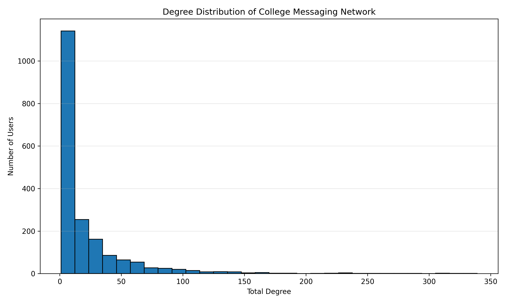
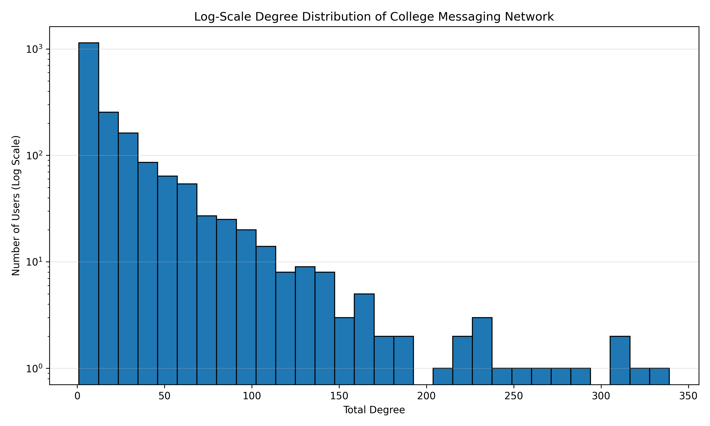
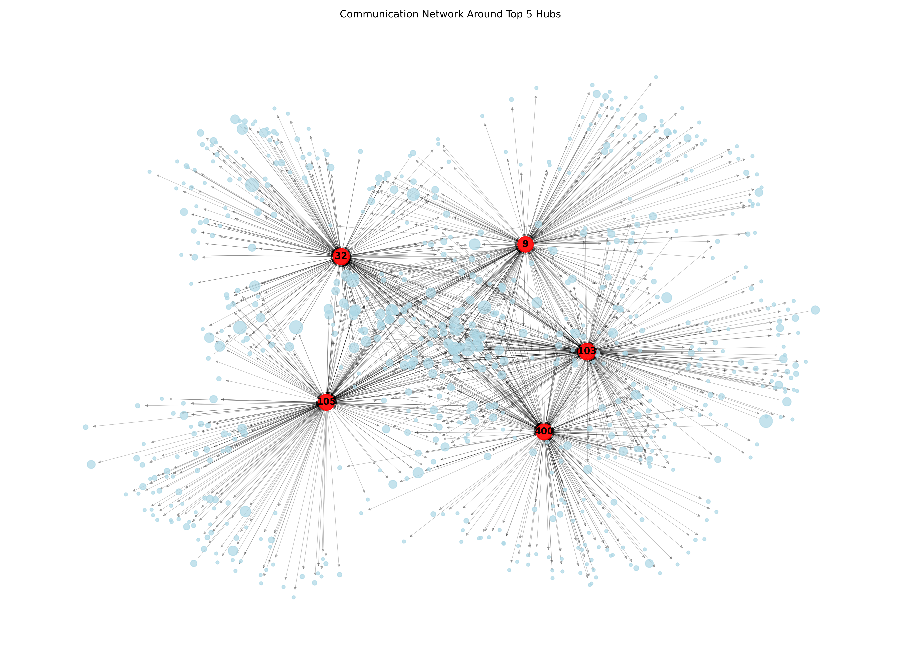
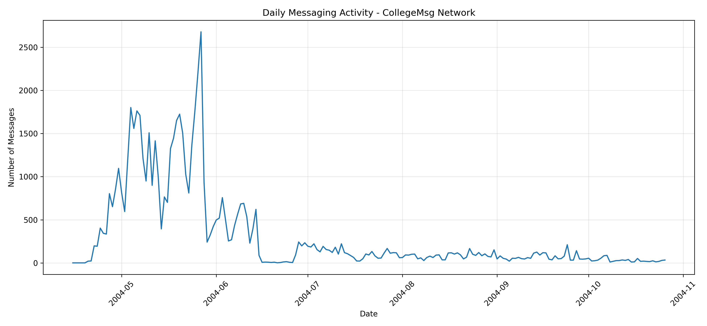
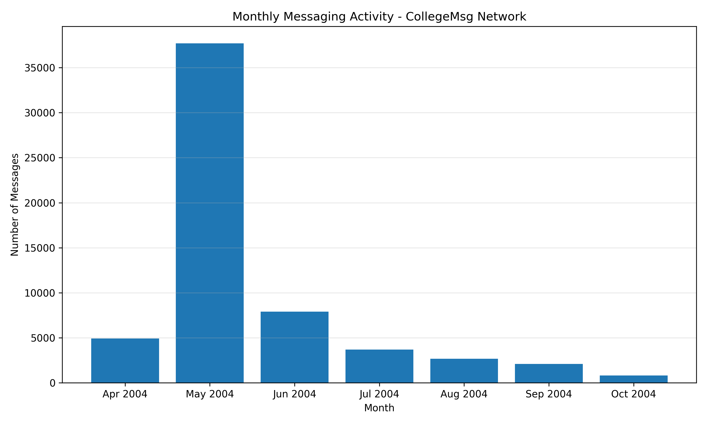
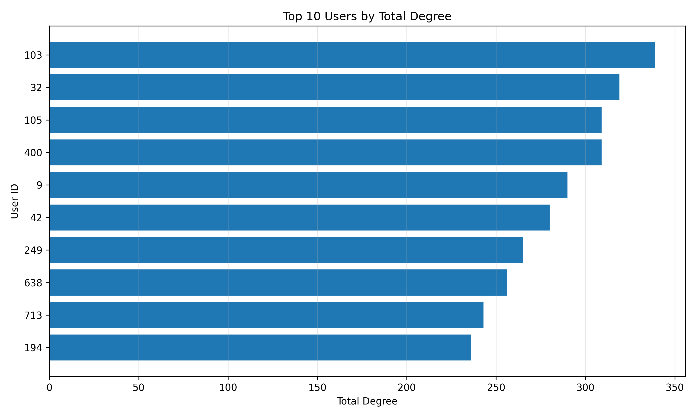
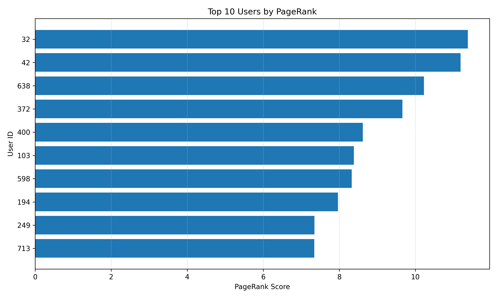

# Online Messaging Network Analysis using Apache Spark GraphX

A distributed graph analytics project that analyzes communication patterns in the Stanford SNAP CollegeMsg dataset using **Apache Spark GraphX and Scala**. The project studies user connectivity, network influence, highly connected users, and temporal messaging activity.

## Project Overview

Online communication platforms generate large networks of interactions between users. Analyzing these interactions helps identify influential users, understand communication patterns, and discover how activity changes over time.

This project constructs a directed messaging network from the CollegeMsg dataset and performs graph analytics using Apache Spark GraphX.

### Key Objectives

- Construct a directed communication network.
- Calculate in-degree, out-degree, and total degree for each user.
- Identify highly connected users and network hubs.
- Calculate PageRank to identify influential users.
- Compare degree centrality rankings with PageRank rankings.
- Analyze daily and monthly messaging activity.
- Visualize network structure and analytical findings.

## Dataset

**Dataset:** CollegeMsg — Stanford Network Analysis Project (SNAP)

**Dataset characteristics:**

| Attribute | Value |
|---|---:|
| Total message events | 59,835 |
| Unique users | 1,899 |
| Unique directed edges | 20,296 |
| Active dates | 193 |
| Active months | 7 |

Each dataset record contains three fields:

1. Sender ID
2. Receiver ID
3. Unix timestamp

The dataset represents temporal communication events. Repeated messages between the same users are retained for temporal analysis, while unique sender-receiver pairs are used to construct the static graph.

Dataset reference: https://snap.stanford.edu/data/CollegeMsg.html

## Technology Stack

| Technology | Purpose |
|---|---|
| Apache Spark 3.5.6 | Distributed data processing |
| Scala 2.12.18 | Application development |
| Spark GraphX | Graph construction and analytics |
| Docker | Spark execution environment |
| Python 3.13 | Visualization |
| Pandas | CSV processing |
| Matplotlib | Charts and plots |
| NetworkX | Network visualization |
| Windows PowerShell | Environment and workflow management |

**Important:** Network metrics and PageRank are calculated using Spark GraphX. NetworkX is used only to render the exported network data.

## Project Architecture

```text
CollegeMsg Dataset
       |
       v
Apache Spark + Scala
       |
       v
Data Processing
       |
       +----------------------+
       |                      |
       v                      v
Directed Graph          Temporal Analysis
(GraphX)                (Daily / Monthly)
       |
       +----------------------+
       |                      |
       v                      v
Degree Metrics           PageRank
       |                      |
       +----------+-----------+
                  |
                  v
           CSV Export
                  |
                  v
       Python Visualization
                  |
                  v
          Analytical Results
```

## Methodology

### 1. Data Processing

The raw messaging dataset is loaded into Spark. Each record is parsed into sender ID, receiver ID, and timestamp.

Two representations are maintained:

- **Message events:** All 59,835 records are preserved for temporal analysis.
- **Unique directed edges:** Repeated sender-receiver pairs are removed to construct the static graph.

### 2. Directed Graph Construction

A directed graph is created using GraphX.

- Vertices represent users.
- Directed edges represent communication from sender to receiver.
- Edge direction preserves the direction of messaging.

### 3. Degree Analysis

Three degree metrics are calculated:

- **In-degree:** Number of unique incoming connections.
- **Out-degree:** Number of unique outgoing connections.
- **Total degree:** Sum of incoming and outgoing connections.

These metrics help identify users who receive, send, or participate in a large number of distinct connections.

### 4. PageRank Analysis

GraphX PageRank is applied to estimate the relative importance of users in the communication network.

The PageRank ranking is compared with the total-degree ranking to identify users who are influential according to both measures.

### 5. Temporal Analysis

Unix timestamps are converted into UTC dates and months.

Messaging activity is aggregated to identify:

- Daily communication patterns.
- Monthly communication patterns.
- Busiest day and month.

### 6. Visualization

Python is used to visualize the exported Spark results through statistical charts, activity plots, and a directed network hub visualization.

## Key Findings

### Network Connectivity

| Metric | User ID | Value |
|---|---:|---:|
| Highest total degree | 103 | 339 |
| Highest in-degree | 32 | 137 |
| Highest out-degree | 9 | 237 |

User 103 has the highest total degree, indicating the largest number of distinct incoming and outgoing connections combined.

### PageRank

The highest PageRank score belongs to User 32, with a score of approximately 11.3821.

Eight users appear in both the top 10 total-degree and top 10 PageRank rankings, demonstrating substantial overlap between the two ranking methods.

### Temporal Activity

| Metric | Result |
|---|---|
| Busiest month | May 2004 |
| Messages in busiest month | 37,698 |
| Busiest day | 27 May 2004 |
| Messages on busiest day | 2,678 |

May 2004 accounts for approximately 63% of all recorded messaging events.

## Visualizations


## Visual Results Gallery

### 1. Degree Distribution

Shows how connections are distributed across users in the messaging network.



### 2. Degree Distribution — Log Scale

A logarithmic view helps examine the long-tailed degree distribution.



### 3. Network Hub Visualization

Displays the selected network subgraph around the five highest-degree users.



### 4. Daily Messaging Activity

Shows how messaging activity changes across active dates.



### 5. Monthly Messaging Activity

Shows the monthly distribution of communication events.



### 6. Top 10 Users by Degree

Compares the incoming, outgoing, and total degree of the ten most connected users.



### 7. Top 10 Users by PageRank

Displays the ten users with the highest PageRank scores.




## Project Structure

```text
OnlineMessagingNetwork/
│
├── dataset/
│   ├── CollegeMsg.txt
│   └── CollegeMsg.txt.gz
│
├── src/
│   └── main/
│       └── scala/
│           └── OnlineMessagingNetwork.scala
│
├── output/
│   └── project_output_final/
│       ├── daily/
│       ├── degrees/
│       ├── monthly/
│       ├── network_edges/
│       └── pagerank/
│
├── visualization/
│   ├── degree_distribution.py
│   ├── degree_distribution_log.py
│   ├── network_hubs.py
│   ├── temporal_activity.py
│   ├── top_degree_users.py
│   ├── top_pagerank_users.py
│   └── *.png
│
├── report/
│
└── README.md
```

## Installation and Execution

### Prerequisites

- Docker Desktop
- Apache Spark 3.5.6 Docker image
- Python 3.13 or compatible Python 3 installation
- Required Python libraries

### Step 1: Install Python dependencies

```powershell
py -3 -m pip install pandas matplotlib networkx
```

### Step 2: Start the Spark container

```powershell
docker start spark-container
```

### Step 3: Copy the dataset and Scala source into Docker

```powershell
docker cp .\dataset\CollegeMsg.txt spark-container:/opt/spark/work-dir/CollegeMsg.txt

docker cp .\src\main\scala\OnlineMessagingNetwork.scala spark-container:/opt/spark/work-dir/OnlineMessagingNetwork.scala
```

### Step 4: Run the Spark application

```powershell
docker exec -it spark-container bash
```

Inside Docker Bash:

```bash
export PATH=/opt/spark/bin:$PATH

spark-shell -i /opt/spark/work-dir/OnlineMessagingNetwork.scala
```

The application performs graph analysis, PageRank, temporal analysis, validation, and CSV export.

### Step 5: Copy analytical outputs to Windows

After successful execution, exit the Scala shell using `:quit`, then exit Docker Bash.

Run in PowerShell:

```powershell
docker cp spark-container:/opt/spark/work-dir/project_output_final C:\OnlineMessagingNetwork\output
```

### Step 6: Generate visualizations

From the project root:

```powershell
py -3 visualization\degree_distribution.py

py -3 visualization\degree_distribution_log.py

py -3 visualization\network_hubs.py

py -3 visualization\temporal_activity.py

py -3 visualization\top_degree_users.py

py -3 visualization\top_pagerank_users.py
```

## Output Datasets

The Spark application generates five CSV datasets:

| Directory | Description |
|---|---|
| `degrees/` | In-degree, out-degree and total degree |
| `pagerank/` | PageRank score for each user |
| `daily/` | Daily messaging counts |
| `monthly/` | Monthly messaging counts |
| `network_edges/` | Unique directed sender-receiver pairs |

## Limitations and Future Improvements

- The static graph represents unique directed connections rather than the frequency of repeated interactions.
- The dataset represents a historical communication network from 2004, not a live messaging platform.
- PageRank and degree metrics capture different forms of network importance.
- Network visualization displays a selected subgraph around the top hubs rather than the entire network.
- Further work could include community detection, temporal network evolution, interaction-frequency analysis, and scalable graph visualization.

## Conclusion

This project demonstrates how Apache Spark GraphX can be used to analyze a real-world directed communication network. It combines graph analytics, influence ranking, temporal analysis, and data visualization to uncover meaningful patterns in user interactions.

The implementation separates distributed graph computation from visualization, providing a reproducible analytical workflow using Scala, Spark, and Python.

---

**Technologies:** Apache Spark | GraphX | Scala | Python | Pandas | Matplotlib | NetworkX | Docker